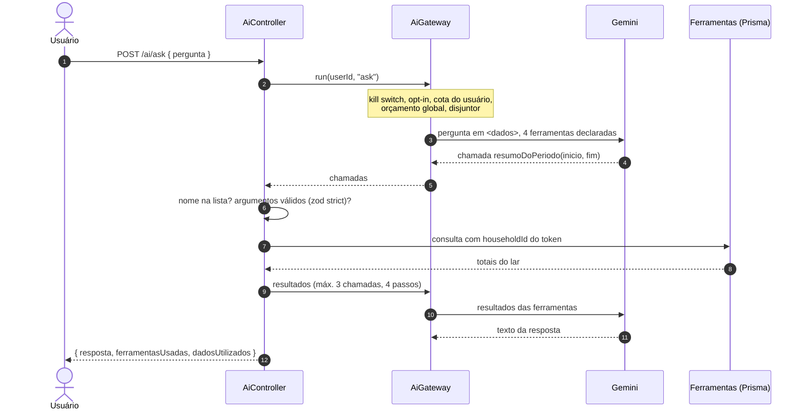
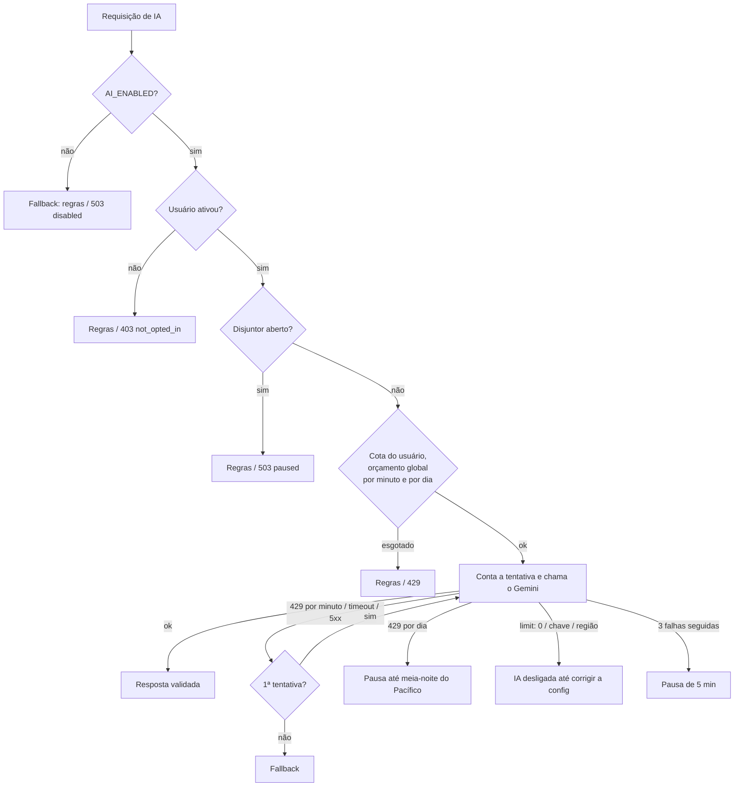

# IA no FinTrack

Duas funcionalidades de IA, pensadas para um app financeiro: úteis, baratas (custo zero) e incapazes de causar estrago mesmo quando o modelo erra ou é manipulado.

- **Sugestão de categoria:** ao digitar a descrição de um lançamento, o formulário sugere uma das categorias do lar. O usuário toca para aceitar.
- **Pergunte ao FinTrack:** perguntas em português ("quanto gastei com alimentação este mês?") respondidas com dados reais do lar, que aparecem ao lado da resposta.

Segurança, privacidade e modelo de ameaças: [SECURITY-AI.md](SECURITY-AI.md).

## Arquitetura

```
backend/src/ai/
├── providers/
│   ├── ai-provider.ts        interface AiProvider (generateStructured, toolStep) e erros tipados
│   ├── gemini.provider.ts    Google Gemini via @google/genai + classify() dos erros
│   └── fake.provider.ts      determinístico, offline, roteirizável nos testes
├── ai-gateway.service.ts     porta única: kill switch, opt-in, cotas, timeout, retentativa, disjuntor, logs
├── ai-throttler.guard.ts     requisições por minuto por usuário (429)
├── categorize/               regras → cache → IA (enum das categorias do lar) → sem sugestão
├── ask/                      loop de tool calling com 4 ferramentas somente leitura
├── text.ts                   limpeza, normalização, chave de cache, delimitação <dados>
└── ai.controller.ts          /api/ai/{categorize,ask,status,settings}
```

O resto do app não conhece o Gemini: tudo passa pela interface `AiProvider`. Trocar de provedor é escrever outra implementação. Em desenvolvimento e no CI roda o `FakeAiProvider` (sem chave, sem rede, sem custo).

### Sugestão de categoria

Ordem pensada para gastar o mínimo de cota:

1. **Regras por palavras-chave** (`uber` → Transporte, `ifood` → Alimentação…): só palavras inteiras, e só se o lar tiver a categoria. Confiança 0,9.
2. **Cache do lar:** a mesma descrição normalizada (sem acento, número e caixa) já foi classificada pela IA antes.
3. **IA:** o schema da resposta é um `enum` com os nomes das categorias do lar daquele tipo. A resposta é validada de novo com zod estrito. Confiança ≥ 0,5 vira sugestão e entra no cache.
4. **Sem sugestão:** o usuário escolhe, como sempre. A rota nunca falha por causa da IA.

### Pergunte ao FinTrack



Ferramentas, todas somente leitura e sempre filtradas pelo lar do usuário logado:

| Ferramenta | Retorna |
| --- | --- |
| `resumoDoPeriodo(inicio, fim)` | Receitas, despesas, saldo e quantidade |
| `gastosPorCategoria(inicio, fim)` | Despesas por categoria, da maior para a menor |
| `totalPorCategoria(categoria, inicio, fim)` | Total e quantidade de uma categoria |
| `maioresDespesas(inicio, fim, limite≤5)` | As maiores despesas com descrição, valor e data |

Períodos: datas `AAAA-MM-DD` reais, início ≤ fim, no máximo 366 dias.

### Cotas e degradação

O plano gratuito do Gemini tem limites **por projeto Google**, compartilhados por todos os usuários. Por isso há três camadas:



Variáveis (veja `backend/.env.example`):

| Variável | Padrão | Papel |
| --- | --- | --- |
| `AI_ENABLED` | `false` | Kill switch |
| `AI_PROVIDER` | `fake` | `fake` ou `gemini` |
| `GEMINI_API_KEY` | (vazio) | Só no backend |
| `GEMINI_MODEL` | `gemini-3.5-flash-lite` | Modelo |
| `AI_TIMEOUT_MS` | `10000` | Timeout por chamada |
| `AI_GLOBAL_RPM` / `AI_GLOBAL_RPD` | `10` / `200` | Orçamento do app inteiro |
| `AI_USER_DAILY_QUOTA` | `30` | Chamadas por usuário por dia (dia do Pacífico) |
| `AI_USER_RPM` | `10` | Requisições por minuto por usuário nas rotas de IA |

**Limites do plano gratuito, conferidos em 22/10/2026:** o Google não publica mais números fixos para o plano gratuito. Os limites (RPM, TPM, RPD) valem por projeto e variam por modelo e conta; o RPD renova à meia-noite do Pacífico. Os valores reais ficam em AI Studio → *View your active rate limits*. Os padrões acima são conservadores; ajuste para 70–80% do que o seu projeto mostra.

## Decisões

| Decisão | Por quê |
| --- | --- |
| Gemini, plano gratuito, sem cobrança | Custo zero para um projeto de portfólio; a abstração permite trocar |
| `gemini-3.5-flash-lite` | Rápido e barato em cota; as tarefas são curtas (classificar, escolher ferramenta) |
| Opt-in + demo | O plano gratuito permite uso e revisão humana dos dados pelo Google; dado financeiro real só vai com consentimento explícito |
| Tool calling fechado, sem SQL gerado | O pior caso vira "resposta errada", nunca vazamento ou escrita |
| Validar a saída no app (zod) mesmo com schema no provedor | A documentação do Gemini recomenda; nem toda restrição do schema é aplicada |
| Contar a tentativa antes da chamada | Retentativas e falhas também gastam cota do Google |
| Saída ruim não abre o disjuntor | Senão um usuário mal-intencionado pausaria a IA para todos |
| Categorização só sugere | A transação é gravada pelo fluxo normal, com as validações de sempre |
| Provedor fake roteirizável | Testes simulam um modelo que obedece à injeção, devolve lixo ou cai, sem rede |

## Limitações conhecidas

- Contadores por minuto e disjuntor em memória (uma instância). A cota diária fica no banco.
- O texto da resposta é livre: pode errar o tom ou a interpretação. Os números de referência estão em "Dados usados".
- O resumo mensal (etapa 3) ainda não foi implementado.
- O SDK `@google/genai` terá uma versão 3.0 com mudanças incompatíveis: a versão está fixada e o `ai:smoke` existe para validar a atualização.

## Testando

```bash
npm --prefix backend run test:e2e   # inclui test/ai.e2e-spec.ts (provedor fake)
npm --prefix backend test           # classify(), regras, GeminiProvider com SDK mockado
npm --prefix frontend test          # sugestão no formulário, resposta renderizada como texto
npm --prefix backend run ai:smoke   # manual, local, Gemini de verdade com dados fictícios
```

## Perguntas de entrevista

**Por que uma interface de provedor se só existe o Gemini?**
Para testar sem rede e sem custo (o fake) e para que a troca de provedor ou de plano não toque no resto do código. Os testes de segurança dependem disso: o fake simula o modelo manipulado.

**O que acontece se o Gemini cair no meio do dia?**
A categorização vira só regras e cache, e o "Pergunte" mostra uma mensagem clara. Depois de 3 falhas seguidas o disjuntor pausa as chamadas por 5 minutos, para não piorar a situação.

**Como você mede custo se é grátis?**
Pela cota: cada chamada grava requisições e tokens de entrada e saída por usuário e por dia (`ai_usage`). O mesmo dado vira custo num plano pago.

**Por que a resposta vem com os dados usados?**
Porque o modelo pode alucinar. Os números exatos das ferramentas, formatados pelo app, ficam ao lado para conferência.
